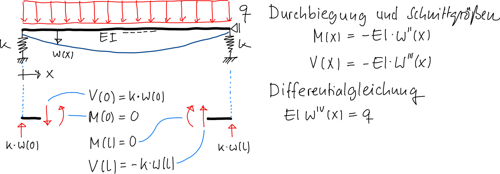

::: {#exr-balken-auf-federn}
## Balken auf Federn

Gegeben ist der dargestellte Balken, der links und rechts auf Federn gelagert ist.

{width="90%" fig-align="center"}

### Auf dem Papier lösen

1. Formulieren Sie das zugehörige Randwertproblem. In den Gleichungen soll als Unbekannte nur die Verschiebungsfunktion $w$ auftauchen.

1. Überführen Sie das Randwertproblem in die schwache Formulierung. Sie müssen hierzu zweimal partiell integrieren.

### Mit dem Computer lösen

1. Stellen Sie die Bilinearform und die Linearform des Variationsproblems auf

1. Werten Sie die schwache Formulierung in Julia für

    $$
    w(x) =
    q \cdot \frac{
      12 \cdot EI \cdot l 
      +
      k \cdot l^3 \cdot x - 2 k \cdot l \cdot x^3
      +
      k \cdot x^4
    }
    {24 \cdot EI \cdot k} 
    $$

    und die Zahlenwerte $l = 3.7$, $EI = 2.2$, $k = 3.9$ und $q = 1.1$ aus. Laden Sie dazu das [Notebook](${slug}-aufgaben.zip){download="${slug}-aufgaben.zip"} herunter, entpacken Sie es in Ihren Projektordner für die Übungen und öffnen Sie es.

    1. Definieren Sie $w$ und eine Testfunktion $\delta w$, zum Beispiel $\delta w(x) = \sin x + x$, und stellen Sie beide Funktionen grafisch dar.

    1. Definieren Sie die Bilinearform $a(w, \delta w)$ und die Linearform $b(\delta w)$ der schwachen Formulierung als Julia-Funktionen. Prüfen Sie, ob $a(w, \delta w) = b(\delta w)$ gilt – auch für andere Testfunktionen wie $\delta w(x) = \sin x + x$. Was können Sie aus dem Ergebnis schließen?

    1. Prüfen Sie, dass $w$ die Differentialgleichung und die Randbedingungen des Randwertproblems erfüllt.

::: {.callout-tip title="Tipps für Julia"}
```{.julia}
x = parameter(0 .. l)       # Variable x auf dem Intervall [0, l]
w = 1 + x^2                 # Funktion von x
w', w'', w'''               # Ableitungen von w
w(0.5)                      # Funktion auswerten
fplot(w, w')                # Funktionen plotten
integrate(w, 0 .. l)        # Funktion w von 0 bis l integrieren
x ≈ y                       # Vergleich mit Rundungstoleranz (\approx)
```
:::

:::
