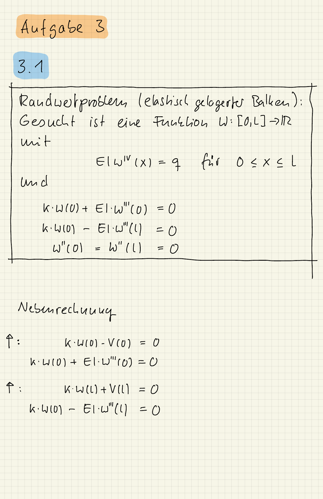
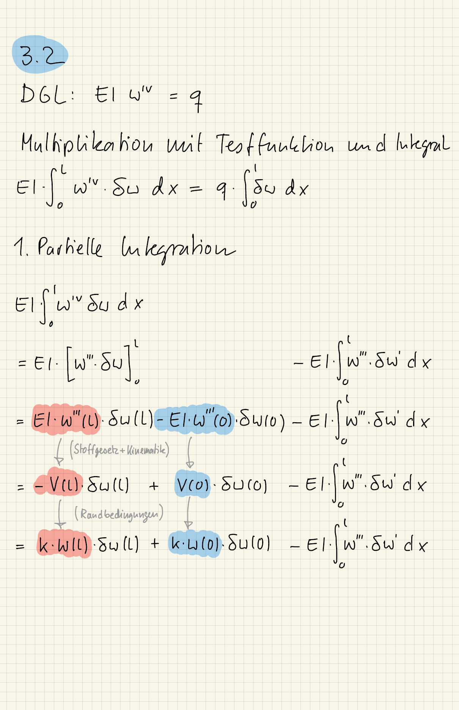
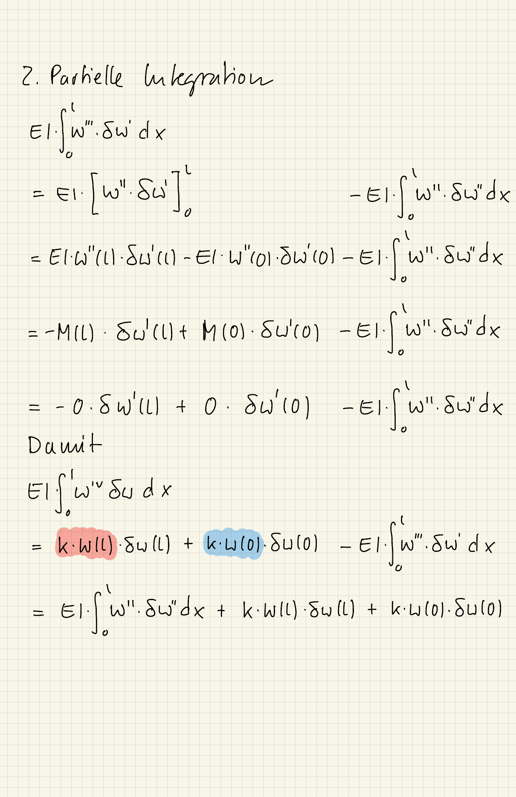
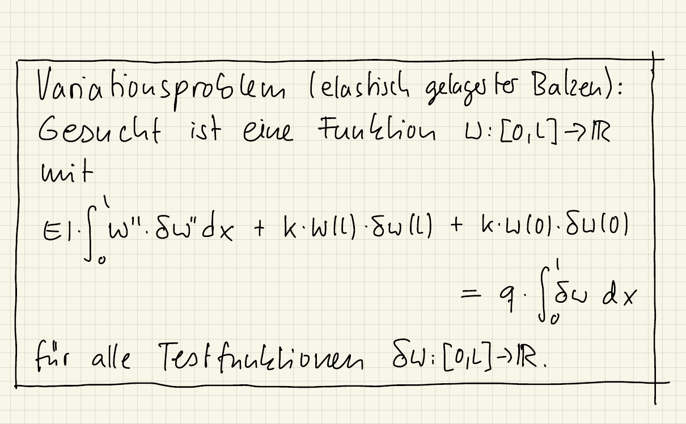

{width="60%" fig-align="center"}

{width="60%" fig-align="center"}

{width="60%" fig-align="center"}

{width="60%" fig-align="center"}

### Errata {-}

- Die Nummerierung stammt aus einer früheren Fassung des Aufgabenblatts: 3.1 ist das Randwertproblem, 3.2 die schwache Form.
- In der zweiten Randbedingung muss es $k \cdot w(l) - EI \cdot w'''(l) = 0$ heißen, nicht $k \cdot w(0) - EI \cdot w'''(l) = 0$ (zweimal auf der ersten Seite: im Randwertproblem und in der Nebenrechnung).

Die Lösung zum Teil "Mit Julia lösen" steht im Lösungs-Notebook.
