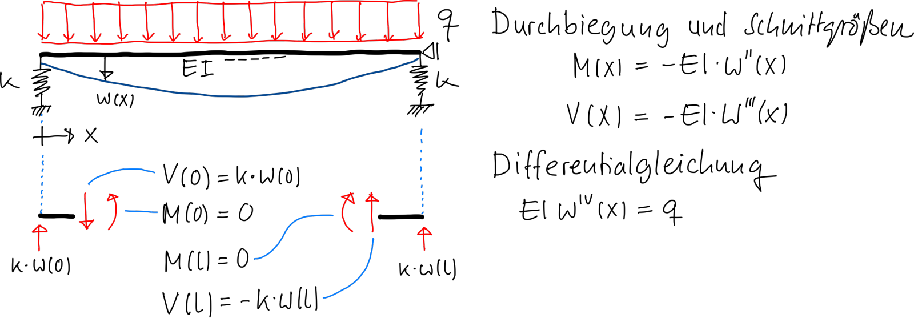
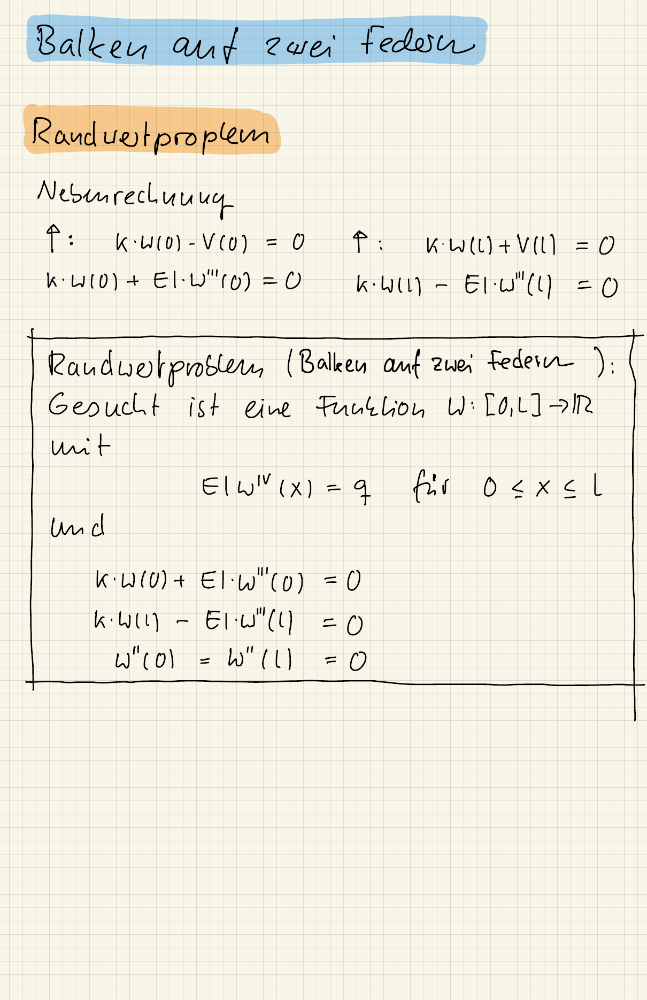
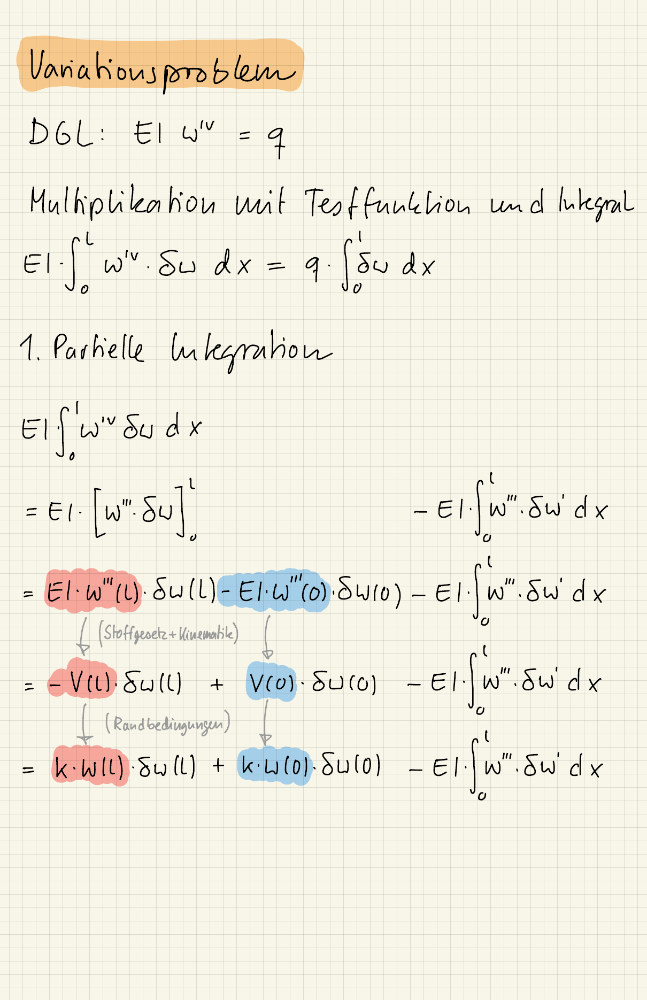
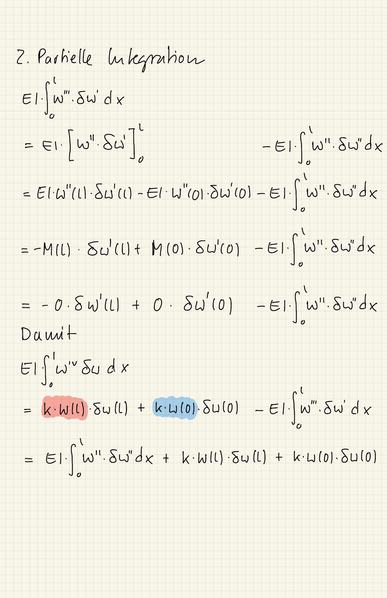
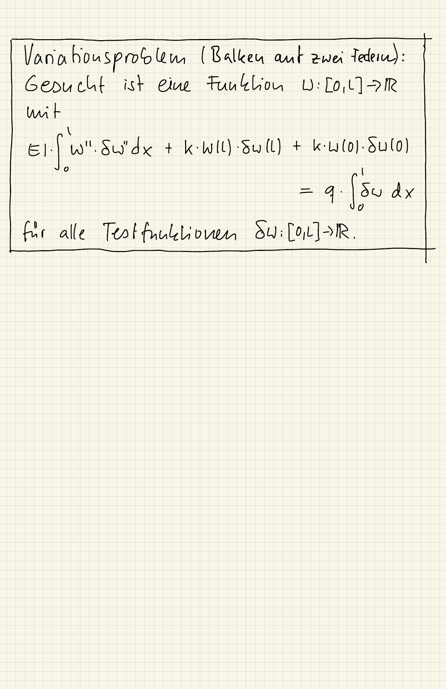

::: {#exr-balken-auf-zwei-federn}
## Balken auf zwei Federn

Gegeben ist der dargestellte Balken, der links und rechts auf Federn gelagert ist.

{width="90%" fig-align="center"}

1. Formulieren Sie das zugehörige Randwertproblem. In den Gleichungen soll als Unbekannte nur die Verschiebungsfunktion $w$ auftauchen.

1. Überführen Sie das Randwertproblem in die schwache Formulierung. Sie müssen hierzu zweimal partiell integrieren.

::: {.lm-solution}
{width="60%" fig-align="center"}

{width="60%" fig-align="center"}

{width="60%" fig-align="center"}

{width="60%" fig-align="center"}
:::
:::
