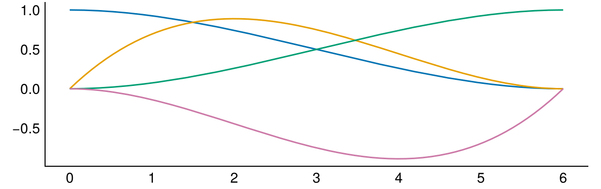

::: {#exr-hermite-basisfunktionen}
## Basisfunktionen mit stetigen Ableitungen

Für die Berechnung von Balkentragwerken mit Finiten Elementen werden Basisfunktionen benötigt, deren Ableitungen stetig sind. Grundlage hierfür sind die so genannten Hermite-Polynome

{width="70%"}

deren Funktionswert oder deren Ableitung an den Enden entweder den Wert null oder eins hat.

Aufgaben:

1. Warum ist es physikalisch nicht möglich, dass die Durchbiegung von Biegebalken (ohne Gelenke) einen Knick hat?
1. Kombinieren Sie die Hermite-Polynome abschnittsweise zu geeigneten Basisfunktionen
1. Welche physikalische Interpretation besitzen dann die Koeffizienten $\hat{w}_i$ in der Linearkombination $w_h(x) = \sum \hat w_i \cdot \varphi(x)$?

:::
