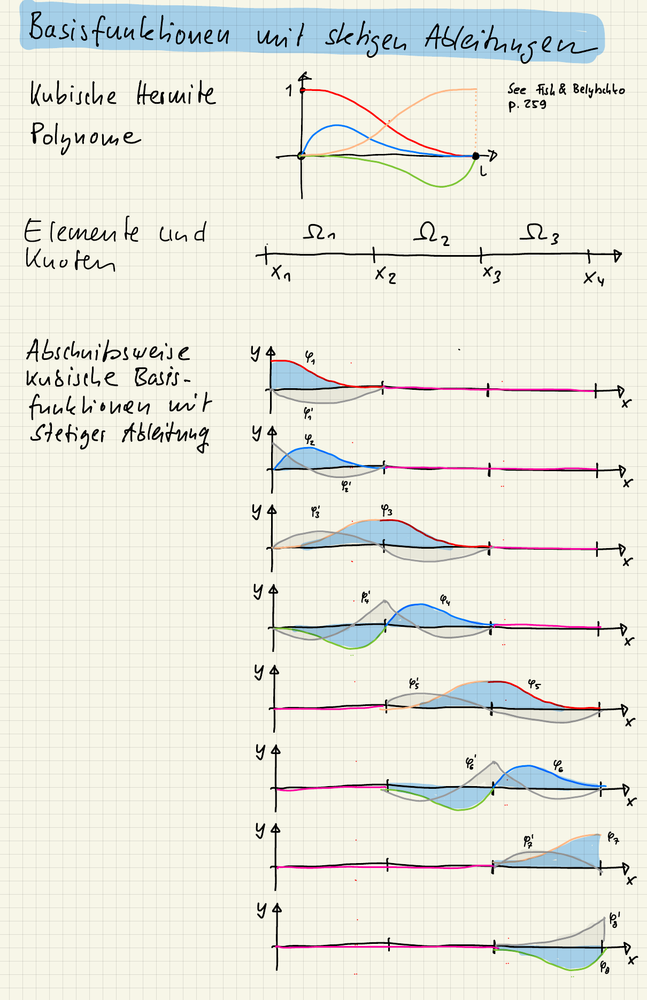

::: {#exr-hermite-basisfunktionen}
## Basisfunktionen mit stetigen Ableitungen

Für die Berechnung von Balkentragwerken mit Finiten Elementen werden Basisfunktionen benötigt, deren Ableitungen stetig sind. Grundlage hierfür sind die so genannten Hermite-Polynome

```{julia}
include(joinpath(dirname(Base.active_project()), "_setup.jl"))
fig = Figure(size = (500, 200))
fplot!(Axis(fig[1, 1]), hermitefunctions([0, 6])...)
fig
```

deren Funktionswert oder deren Ableitung an den Enden entweder den Wert null oder eins hat (siehe @fish_first_2007, S. 260).

Aufgaben:

1. Warum ist es physikalisch nicht möglich, dass die Durchbiegung von Biegebalken (ohne Gelenke) einen Knick hat?

1. Kombinieren Sie die Hermite-Polynome abschnittsweise zu geeigneten Basisfunktionen und skizzieren Sie den Verlauf.

1. Skizzieren Sie zusätzlich noch die erste Ableitung der Basisfunktionen. Denken Sie daran, dass die Ableitung einer kubischen Funktion quadratisch ist.

1. Welche physikalische Interpretation besitzen dann die Koeffizienten $\hat{w}_i$ in der Linearkombination $w_h(x) = \sum \hat w_i \cdot \varphi_i(x)$?

::: {.tinh-solution}
Zu Teil 1: Der Balken würde brechen.

Zu Teil 2 und 3:

{width="60%" fig-align="center"}

Zu Teil 4: Koeffizienten mit ungeradem Index entsprechen einer Verschiebung, Koeffizienten mit einem geraden Index einer Verdrehung.

:::
:::
