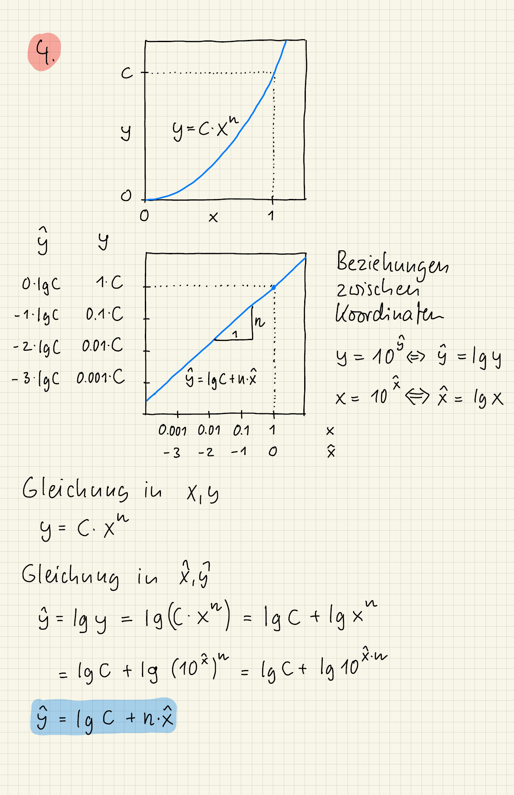

{width="60%" fig-align="center"}

Zu Teil 2: Für kleine $h$ ist die Steigung 2, der Fehler verhält sich also wie $C \cdot h^2$. Halbiert man $h$, wird der Fehler etwa um den Faktor $2^2 = 4$ kleiner. Bei sehr groben Netzen (wenige Elemente) gilt das noch nicht.

Die Lösung zum Teil "Mit Julia lösen" steht im Lösungs-Notebook.

### Errata {-}

- Die Nummerierung "4." stammt aus einer früheren Fassung des Aufgabenblatts.
