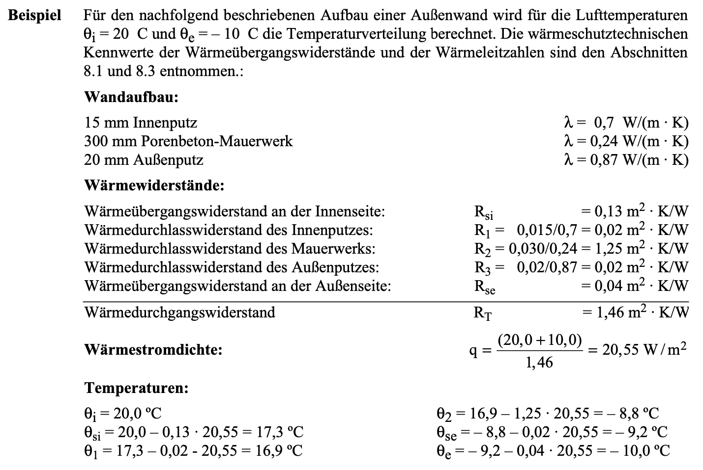

::: {#exr-testbeispiel}
## Testbeispiel

Überprüfen Sie ihr Programm für unterschiedliche Materialparameter und Robin-Randbedingungen anhand des Rechenbeispiels

{width="70%" fig-align="center"}

aus Fischer et al. (2008): Lehrbuch der Bauphysik.

:::
