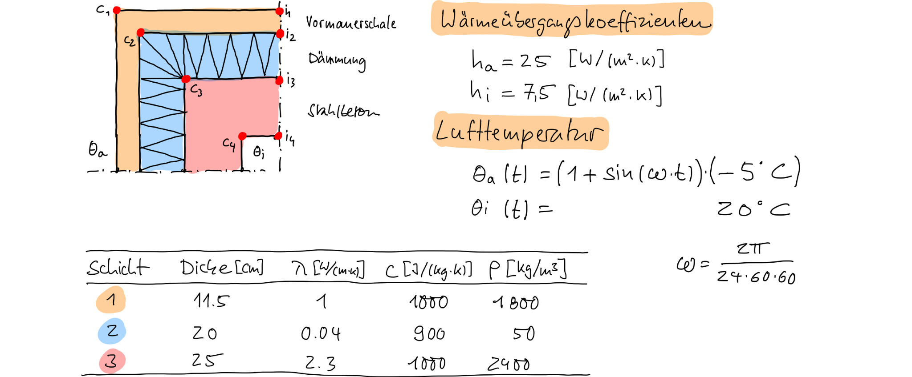

::: {#exr-raumecke}
## Raumecke mit wechselnder Außentemperatur

Simulieren Sie für die dargestellte Situation die Temperaturverteilung über einen Zeitraum von 48 Stunden. Verwenden Sie dabei die stationäre Lösung für $t=0$ als Anfangstemperaturverteilung.

Die Funktion der DGL lautet für dieses Beispiel

$$
  \mathbf{F}(t, \boldsymbol{\theta})
  =
  \mathbf{M}^{-1}
  \left(
    -\mathbf{K}\boldsymbol{\theta} 
    + 
    \mathbf{r}_\mathrm{i} 
    +
    (1 + \sin(\omega t)) \cdot \mathbf{r}_\mathrm{a}
  \right)
$$

wobei $\mathbf{r}_\mathrm{i}$ und $\mathbf{r}_\mathrm{a}$ die rechten Seiten zum inneren bzw. äußeren Rand sind.

Tipps: 

- In Julia lässt sich das Anfangswertproblem auch ohne die Inverse der Massenmatrix lösen

- Verwenden Sie die auf Moodle bereitgestellten Dateien als Ausgangspunkt

:::
