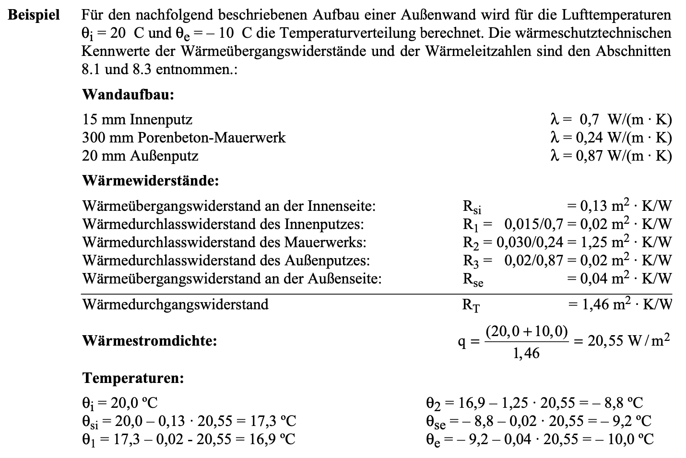

```{julia}
#| label: setup
#| include: false
using Revise
import CairoMakie: update_theme!, lines
using MMJMesh
using MMJMesh.Plots
using MMJMesh.Meshes
using MMJMesh.Geometries
using MMJMesh.Mathematics
using LinearAlgebra
include("src/fem.jl")
include("src/heat.jl")
update_theme!(colormap=:acton)
```

::: {#exr-testbeispiel}
## Testbeispiel

Überprüfen Sie ihr Programm für unterschiedliche Materialparameter und Robin-Randbedingungen anhand des Rechenbeispiels

{width="70%" fig-align="center"}

aus Fischer et al. (2008): Lehrbuch der Bauphysik.

::: {.lm-solution}
Parameter

```{julia}
ti = 20
hi = 1 / 0.13
ta = -10
ha = 1 / 0.04
```

Netz

```{julia}
write(
    "wall.geo",
    raw"""
SetFactory("OpenCASCADE");

Rectangle(1) = {0, 0, 0, 0.015, 0.1, 0};
Rectangle(2) = {0.015, 0, 0, 0.3, 0.1, 0};
Rectangle(3) = {0.315, 0, 0, 0.02, 0.1, 0};
Coherence;

Physical Curve("wi") = {4};
Physical Curve("wa") = {9};
Physical Surface("s1") = {1};
Physical Surface("s2") = {2};
Physical Surface("s3") = {3};

MeshSize{:} = 0.015/2;
Mesh 2;

Save "wall.msh";
"""
);
```

```{julia}
m = Mesh("wall.geo")
mplot(m, edgesvisible=true) |> mconf()
```

Problem definieren

```{julia}
setdata!(group(m, :s1), :ke_func, heat_ke(0.7))
setdata!(group(m, :s2), :ke_func, heat_ke(0.24))
setdata!(group(m, :s3), :ke_func, heat_ke(0.87))
setdata!(group(m, :wi), :ke_func, robin_ke(hi))
setdata!(group(m, :wi), :re_func, robin_re(hi, ti))
setdata!(group(m, :wa), :ke_func, robin_ke(ha))
setdata!(group(m, :wa), :re_func, robin_re(ha, ta))
```

Gleichungssystem aufstellen und lösen

```{julia}
K, r = assemble_kr(m);
θHat = K \ r;
```

Temperaturverteilung

```{julia}
mplot(m, θHat) |> mconf()
```

```{julia}
nds = nodes(m, on(HLine(0)))
idxs = index.(nds)

lines(coordinates(m, idxs)[1, :], θHat[idxs])
```

Vergleich mit den Werten aus Fischer et al.

```{julia}
using Printf
pres(l, v1, v2) = @printf "%s: %.3f, d: %.3f\n" l v1 abs(v1 - v2)

t1 = θHat[index(m, 0, on(Point(0, 0)))]
t2 = θHat[index(m, 0, on(Point(0.015, 0)))]
t3 = θHat[index(m, 0, on(Point(0.015 + 0.3, 0)))]
t4 = θHat[index(m, 0, on(Point(0.015 + 0.3 + 0.02, 0)))]

pres("t1", t1, 17.3)
pres("t2", t2, 16.9)
pres("t3", t3, -8.8)
pres("t4", t4, -9.2)
```
:::
:::
