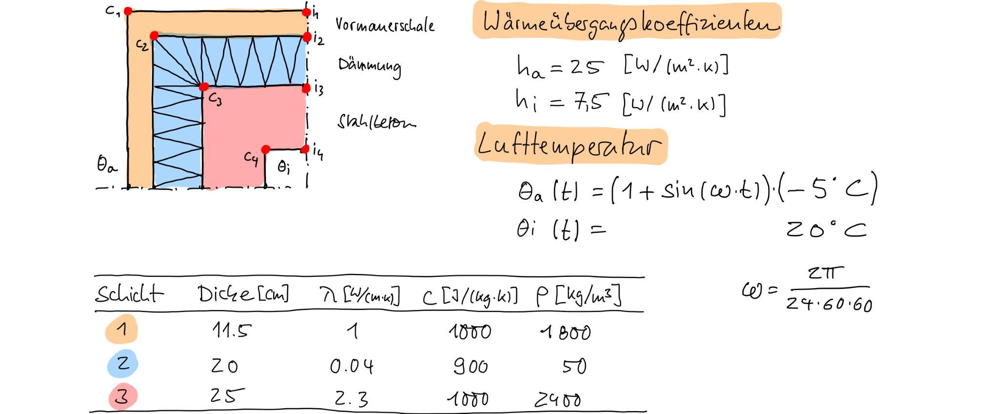

```{julia}
#| label: setup
#| include: false
using Revise
using MMJMesh
using MMJMesh.Plots
using MMJMesh.Meshes
using MMJMesh.Geometries
using MMJMesh.Mathematics
using SparseArrays
using DifferentialEquations
using CairoMakie: update_theme!, scatter!, lines, lines!, axislegend
include("src/fem.jl")
include("src/heat.jl")
update_theme!(colormap=:acton)
```

::: {#exr-raumecke}
## Raumecke mit wechselnder Außentemperatur

Simulieren Sie für die dargestellte Situation die Temperaturverteilung über einen Zeitraum von 48 Stunden. Verwenden Sie dabei die stationäre Lösung für $t=0$ als Anfangstemperaturverteilung.



Die Funktion der DGL lautet für dieses Beispiel

$$
  \mathbf{F}(t, \boldsymbol{\theta})
  =
  \mathbf{M}^{-1}
  \left(
    -\mathbf{K}\boldsymbol{\theta}
    +
    \mathbf{r}_\mathrm{i}
    +
    (1 + \sin(\omega t)) \cdot \mathbf{r}_\mathrm{a}
  \right)
$$

wobei $\mathbf{r}_\mathrm{i}$ und $\mathbf{r}_\mathrm{a}$ die rechten Seiten zum inneren bzw. äußeren Rand sind.

Tipps:

- In Julia lässt sich das Anfangswertproblem auch ohne die Inverse der Massenmatrix lösen

- Verwenden Sie die auf Moodle bereitgestellten Dateien als Ausgangspunkt

::: {.lm-solution}
Netz und Punkte

```{julia}
write("corner.geo", raw"""
SetFactory("OpenCASCADE");

d1 = 0.115;
d2 = 0.200;
d3 = 0.250;
l0 = 1;

Point(1)  = {           0, 0, 0};
Point(2)  = {          d1, 0, 0};
Point(3)  = {     d1 + d2, 0, 0};
Point(4)  = {d1 + d2 + d3, 0, 0};

Point(5)  = {           0, l0 + d3 + d2 + d1, 0};
Point(6)  = {          d1, l0 + d3 + d2,      0};
Point(7)  = {     d1 + d2, l0 + d3,           0};
Point(8)  = {d1 + d2 + d3, l0,                0};

Point(9)  = {d1 + d2 + d3 + l0, l0 + d3 + d2 + d1, 0};
Point(10) = {d1 + d2 + d3 + l0, l0 + d3 + d2,      0};
Point(11) = {d1 + d2 + d3 + l0, l0 + d3,           0};
Point(12) = {d1 + d2 + d3 + l0, l0,                0};

Line(1) = {1, 2};
Line(2) = {2, 3};
Line(3) = {3, 4};
Line(4) = {1, 5};
Line(5) = {2, 6};
Line(6) = {3, 7};
Line(7) = {4, 8};
Line(11) = {5, 9};
Line(12) = {6, 10};
Line(13) = {7, 11};
Line(14) = {8, 12};
Line(15) = {9, 10};
Line(16) = {10, 11};
Line(17) = {11, 12};

Curve Loop(1) = {1, 5, 12, -15, -11, -4};
Curve Loop(2) = {2, 6, 13, -16, -12, -5};
Curve Loop(3) = {3, 7, 14, -17, -13, -6};

Plane Surface(1) = {1};
Plane Surface(2) = {2};
Plane Surface(3) = {3};

Physical Curve("wi") = {7, 14};
Physical Curve("wa") = {4, 11};
Physical Surface("s1") = {1};
Physical Surface("s2") = {2};
Physical Surface("s3") = {3};


Coherence;

MeshSize{:} = 0.025;

Mesh 2;

Save "corner.msh";
""");
```

```{julia}
m = Mesh("corner.geo")

c1 = nodeindex(m, on(Point(0.000, 1.565)))
c2 = nodeindex(m, on(Point(0.115, 1.450)))
c3 = nodeindex(m, on(Point(0.315, 1.250)))
c4 = nodeindex(m, on(Point(0.565, 1.000)))
i1 = nodeindex(m, on(Point(1.565, 1.565)))
i2 = nodeindex(m, on(Point(1.565, 1.450)))
i3 = nodeindex(m, on(Point(1.565, 1.250)))
i4 = nodeindex(m, on(Point(1.565, 1.000)))
nds = [c1, c2, c3, c4, i1, i2, i3, i4]

p = mplot(m, edgesvisible=true) |> mconf()
scatter!(coordinates(m, nds))
p
```

Materialparameter und Randbedingungen

```{julia}
setdata!(group(m, :s1), :kefunc, heat_ke(1.0))
setdata!(group(m, :s1), :me_func, heat_me(1800, 1000))
setdata!(group(m, :s2), :kefunc, heat_ke(0.04))
setdata!(group(m, :s2), :me_func, heat_me(50, 900))
setdata!(group(m, :s3), :kefunc, heat_ke(2.3))
setdata!(group(m, :s3), :me_func, heat_me(2400, 1000))
setdata!(group(m, :wa), :kefunc, robin_ke(25))
setdata!(group(m, :wa), :refunc, robin_re(25, -5))
setdata!(group(m, :wi), :kefunc, robin_ke(7.5))
setdata!(group(m, :wi), :refunc, robin_re(7.5, 20))
```

Systemmatrizen und -vektor

```{julia}
K, M, r = assemble_kmr(m);
```

Stationäre Berechnung

```{julia}
theta0 = K \ r;
mplot(m, theta0) |> mconf()
```

Transiente Berechnung: Anteile für innen und außen in `r` auf zwei Vektoren aufteilen

```{julia}
gi = group(m, :wi0)
ri = zeros(nnodes(m))
ri[gi] .= r[gi]

ga = group(m, :wa0)
ra = zeros(nnodes(m))
ra[ga] .= r[ga];
```

Kontrolle

```{julia}
K \ (ri + ra) ≈ theta0
```

Anfangswertproblem lösen

```{julia}
ω = 2 * π / (24 * 60 * 60)
F(T, _, t) = -K * T + ri + (1 + sin(ω * t)) * ra
JF(_, _, _) = -K

FM = ODEFunction(F, mass_matrix=M, jac=JF);
p = ODEProblem(FM, theta0, [0.0, 2 * 24 * 60 * 60])
sol = solve(p, QNDF());
```

Zeit und Temperaturen in Matrix

```{julia}
t = sol.t / 3600
theta = stack(sol.u, dims=1);
```

Plot außen

```{julia}
p = lines(t, theta[:,c1], label="c1")
lines!(t, theta[:,c2], label="c2")
lines!(t, theta[:,i1], label="i1")
lines!(t, theta[:,i2], label="i2")
axislegend(position=:rb)
p
```

Plot innen

```{julia}
p = lines(t, theta[:,c3], label="c3")
lines!(t, theta[:,c4], label="c4")
lines!(t, theta[:,i3], label="i3")
lines!(t, theta[:,i4], label="i4")
axislegend(position=:rb)
p
```

Temperaturverteilung im letzten Schritt

```{julia}
mplot(m, sol[end]) |> mconf()
```
:::
:::
