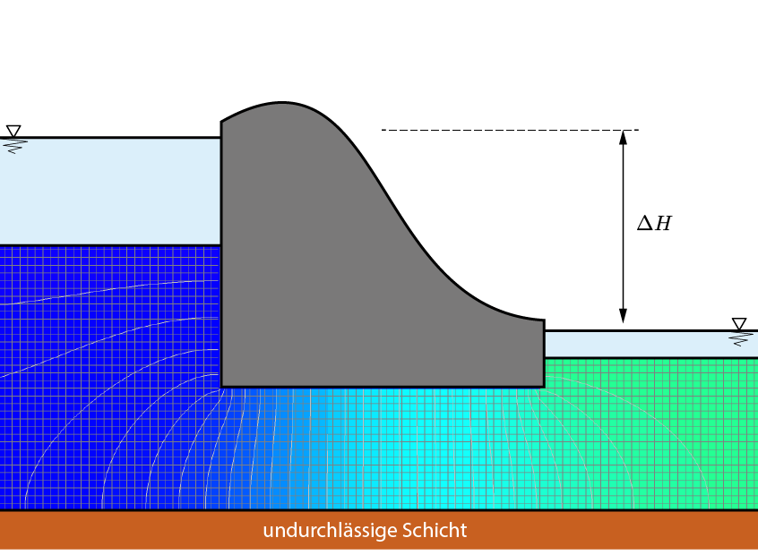
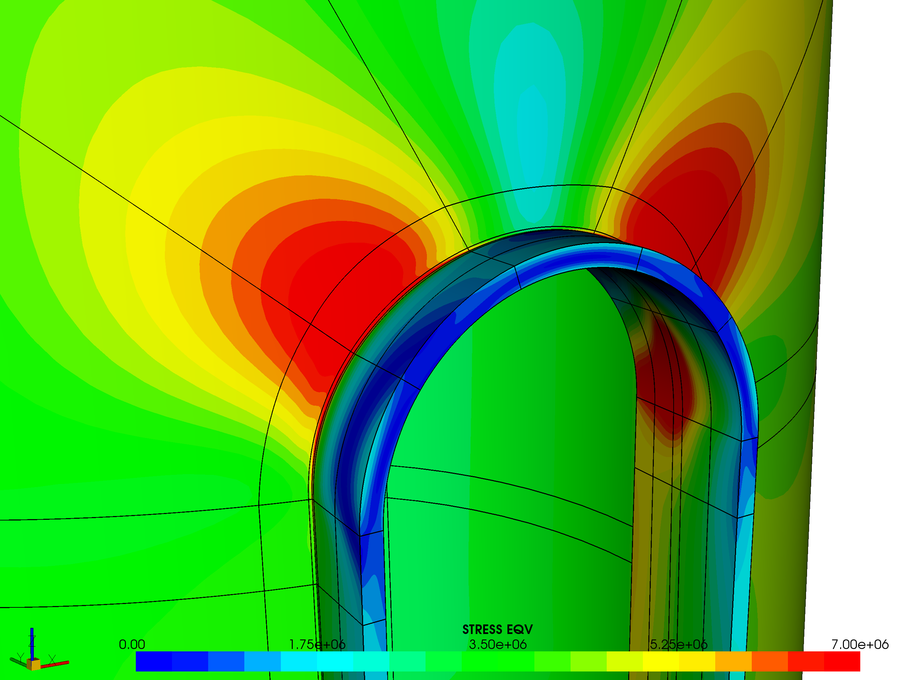
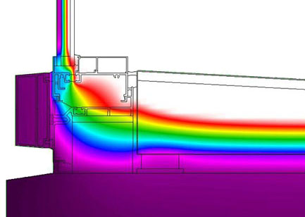
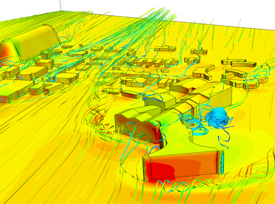
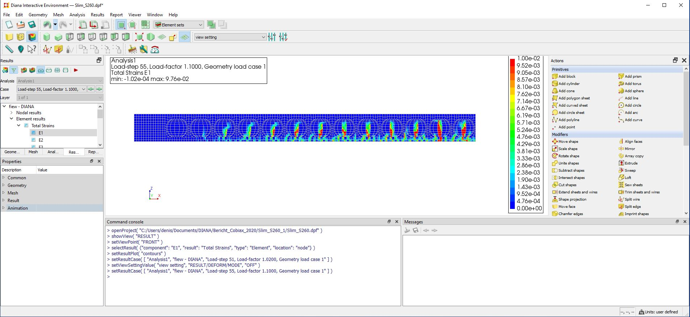
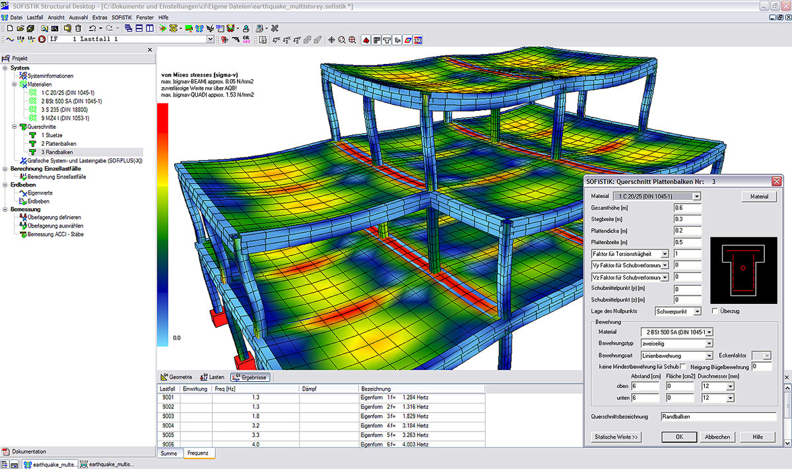
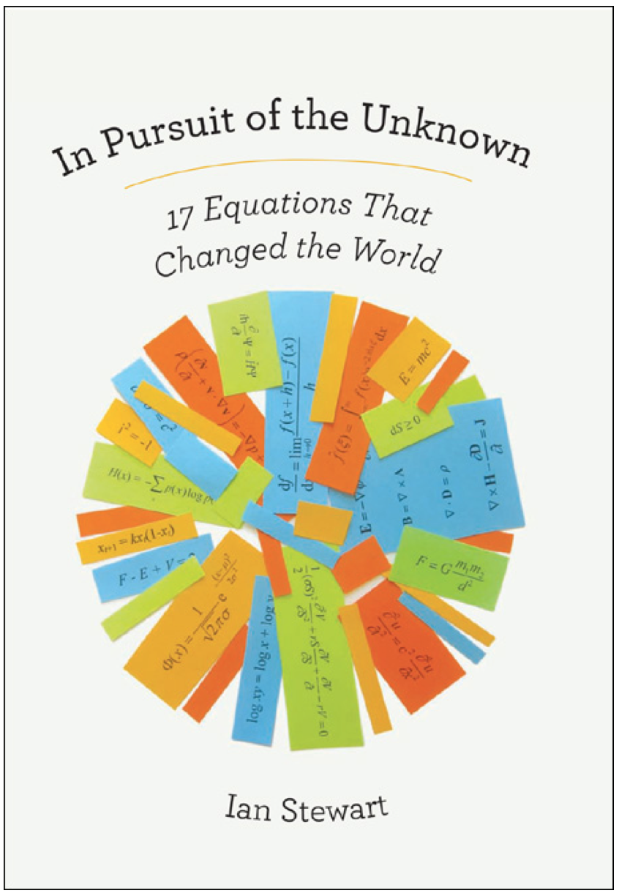
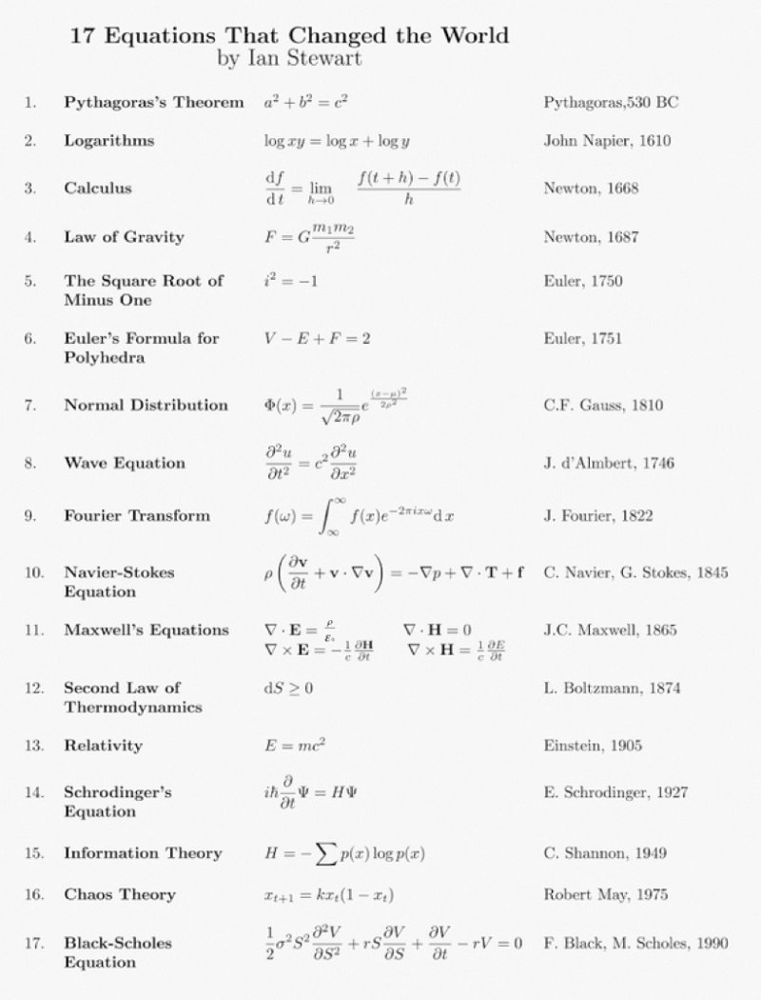
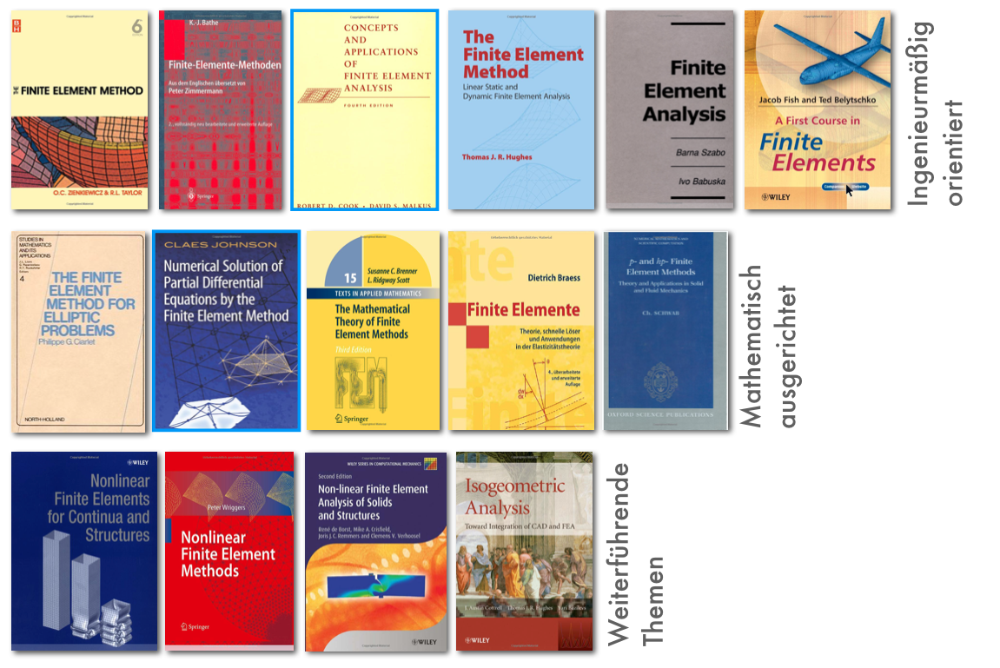

##

[]{.down80}

:::: {.columns}
::: {.column width="25%"}

:::
::: {.column width="25%"}

:::
::: {.column width="25%"}

:::
::: {.column width="25%"}

:::
::::

## DIANA FEA

- Simulation einer Hohlkörperdecke mit Rissbildung (Dr. Denis Busch)

## SOFiSTiK

- Berechnung Bürogebäude, BIM-Seminar (Stephan Seibel)

## Berechnung der Durchbiegung einer Deckenplatte

Funktion der Durchbiegung $w : \Omega \to \mathbb{R}$ beschrieben durch partielle Differentialgleichung

$$
\frac{E h^3}{12(1-\nu^2)}
\left(
  \frac{\partial^4 w(x, y)}{\partial x^4} +
  2\frac{\partial^4 w(x, y)}{\partial x^2\partial y^2} +
  \frac{\partial^4 w(x, y)}{\partial y^4}
\right) = q
$$

und Randbedingungen.

[]{.down40}

- Randwertproblem
- Nur in Ausnahmefällen auf dem Papier lösbar
- Viele praktische Probleme haben genau dieselbe Struktur

  ⟶ Wärmeleitung, Wellenausbreitung, Strömung von Fluiden

## 17 Gleichungen, die Geschichte machten

:::: {.columns}
::: {.column width="45%"}

:::
::: {.column width="5%"}
:::
::: {.column width="50%"}

:::
::::

## Lösung heute mit der Methode der finiten Elemente

{width="80%" fig-align="center"}

- Näherungsverfahren für gewöhnliche und partielle DGLn
- Vielfältigste Anwendungsmöglichkeiten
- Unmenge an Literatur

## Über dieses Modul

- Theorie zu Modellierung, mathematischer Formulierung und numerischen Lösungsverfahren
- Umsetzung der Methoden in der Programmiersprache Julia
- Vorlesungen in Form von Videos
- In Präsenz: Diskussion und Programmieren
- Prüfungsleistung: Portfolioprüfung mit Übungsaufgaben und Hausarbeit
